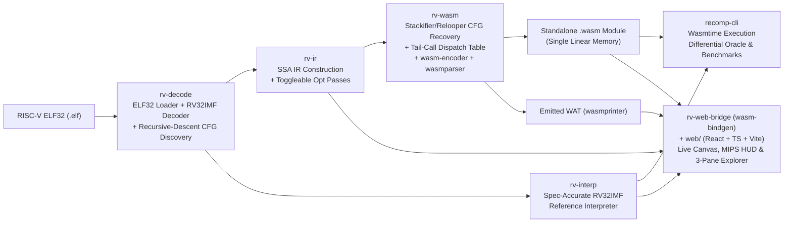

# Master Plan: RISC-V (RV32IMF) to WebAssembly Static Binary Recompiler

> **Status:** Planning / Pre-Implementation Blueprint  
> **Target Repository:** `RISC-V-(RV32IMF)-to-WebAssembly-Static-Recompiler`  
> **Core Goal:** Zero-backend, Ahead-of-Time (AOT) static binary recompiler in Rust lifting unmodified 32-bit RISC-V (`RV32IM` + `F`) static ELF binaries into validated, optimized, standalone WebAssembly (`.wasm`) modules—running natively via CLI and 100% client-side in the browser alongside a reference interpreter and 3-pane Compiler Explorer.

---

## 1. Architectural Overview



### Key Architectural Principles
1. **Correctness First via Differential Oracle:** Every phase validates recompiled `.wasm` output bit-for-bit against `rv-interp` (register state `x0–x31`, `f0–f31`, `fcsr`, linear memory CRC32, and `stdout`).
2. **Universal Browser Compatibility:** Single Wasm linear memory (no `multi-memory`), targeting universally supported post-MVP Wasm features: `tail-call` (`return_call`, `return_call_indirect`), `saturating-float-to-int`, `sign-extension`, and `mutable-global`.
3. **100% Static Deployment:** The compiler itself compiles to `wasm32-unknown-unknown` via `wasm-bindgen`; zero backend servers or remote toolchains are required at runtime.
4. **Measurable Compiler Engineering:** Every optimization pass in `rv-ir` is individually toggleable so `-O0` vs `-O2` vs Interpreter speedups are empirically measurable in both `recomp-cli bench` and the browser demo.

---

## 2. Environment & Toolchain Setup

Based on the current local machine environment (`rustc 1.100.0`, `cargo 1.100.0`, Node `v24.13.1`, npm `11.8.0`, Homebrew present), Phase 0 must install the following missing cross-compilation and Wasm build targets:

| Tool / Target | Purpose | Install Command |
| :--- | :--- | :--- |
| `wasm32-unknown-unknown` | Compile `rv-web-bridge` to browser Wasm | `rustup target add wasm32-unknown-unknown` |
| `riscv32im-unknown-none-elf` | Build bare-metal Rust RV32IM guests | `rustup target add riscv32im-unknown-none-elf` |
| `wasm-pack` / `wasm-bindgen-cli` | Bundle `rv-web-bridge` JS/Wasm glue | `cargo install wasm-bindgen-cli --version 0.2.130` (or `wasm-pack`) |
| Homebrew `llvm` (`clang`, `ld.lld`, `llvm-objdump`) | Build C RV32IM / RV32IMF guests (`-march=rv32imf -mabi=ilp32f -mno-relax`) without compressed `C` instructions | `brew install llvm` |

> [!IMPORTANT]
> **Avoiding Compressed (`C`) Instructions in Guests:** Built-in `riscv32imafc-unknown-none-elf` enables the `C` (16-bit) extension, which is an explicit v1 non-goal. For C guests, always compile with Homebrew Clang using `--target=riscv32-unknown-elf -march=rv32im -mabi=ilp32 -mno-relax` (or `-march=rv32imf -mabi=ilp32f -mno-relax` for F workloads). For Rust RV32IMF guests, use a custom target JSON (`guests/targets/riscv32imf-unknown-none-elf.json` disabling `+c` and enabling `+m,+f`) or compile RV32IM Rust guests with `riscv32im-unknown-none-elf`.

### Core Crate Version Pins (Workspace `Cargo.toml`)
- `object = "0.41.0"` — ELF32 parsing (`PT_LOAD`, `.symtab`, entry point, sections)
- `wasm-encoder = "0.263.0"` — Direct in-memory Wasm binary emission
- `wasmparser = "0.263.0"` — Immediate structural & semantic Wasm validation
- `wasmprinter = "0.263.0"` — Accurate `.wasm` → WAT rendering for the Compiler Explorer
- `wasm-bindgen = "0.2.130"` — Rust ↔ JS/TS bridge in `rv-web-bridge`
- `wasmtime` (latest compatible in native `recomp-cli` and workspace dev-dependencies) — Native headless execution & benchmarking
- `crc32fast`, `serde`, `serde_json`, `clap`, `proptest`, `thiserror`

---

## 3. Target Workspace Layout

```text
.
├── Cargo.toml                      # Rust workspace manifest & shared dependency pins
├── MASTER_PLAN.md                  # This architectural blueprint
├── crates/
│   ├── rv-abi/                     # Shared Virtual Hardware ABI constants, memory map, syscall IDs
│   ├── rv-decode/                  # Pure Rust RV32IMF decoder, disassembler, ELF32 loader, CFG discovery
│   ├── rv-ir/                      # SSA IR types, Braun SSA builder, CFG analysis, toggleable opt passes
│   ├── rv-wasm/                    # Stackifier/Relooper, tail-call dispatch table, wasm-encoder, validator
│   ├── rv-interp/                  # Spec-accurate RV32IMF reference interpreter + host trait
│   ├── rv-web-bridge/              # wasm-bindgen crate for client-side recompilation & inspection
│   └── recomp-cli/                 # Native CLI: compile, run, diff-test, bench (Markdown tables)
├── guests/
│   ├── common/                     # Shared link.ld, crt0.S, rv_abi.h, minilibc.c, rv_guest Rust crate
│   ├── targets/                    # Custom riscv32imf-unknown-none-elf.json target spec
│   ├── compliance/                 # RV32IM + RV32F micro-test suite
│   ├── benchmarks/                 # Mandelbrot, MatMul, Dhrystone/CoreMark-style integer benchmark
│   ├── raycaster/                  # Interactive 60 FPS Software 3D Raycaster / Rotating Cube
│   ├── life/                       # Conway's Game of Life (C)
│   ├── doom/                       # doomgeneric Shareware (unmodified C core + RV ABI platform shim)
│   └── build.sh                    # Reproducible guest ELF builder outputting into web/public/presets/
└── web/                            # React + TypeScript + Vite interactive demo & 3-pane Compiler Explorer
    ├── public/presets/             # Pre-built *.elf guest binaries
    ├── src/
    │   ├── worker/                 # Web Worker VM runner (Recompiled Wasm + Interpreter)
    │   ├── components/             # Canvas viewport, HUD, 3-Pane Explorer, CFG Graph Viewer, Uploader
    │   └── lib/                    # Bridge bindings, SAB/postMessage transport, keyboard/mouse MMIO
    ├── vercel.json                 # COOP/COEP headers for SharedArrayBuffer
    └── public/_headers             # Cloudflare Pages COOP/COEP headers
```

---

## 4. Virtual Hardware ABI & Runtime Specification

Both `rv-interp` and recompiled `.wasm` modules target the exact same deterministic Virtual Machine ABI inside a **single Wasm linear memory**.

### 4.1 Single Linear Memory Map (Initial = Maximum = 290 Wasm Pages ≈ 18.56 MB)

| Address Range | Size | Purpose |
| :--- | :--- | :--- |
| `0x0000_0000 – 0x0000_0FFF` | 4 KB | Null-pointer guard page (unmapped/zeroed; guest `.text` begins at `0x0001_0000`) |
| `0x0001_0000 – 0x00FF_FFFF` | ~16 MB | Guest `.text`, `.rodata`, `.data`, `.bss`, upward bump heap (`sys_sbrk`), downward 16-byte-aligned stack (`sp_init = 0x00FF_FFF0`) |
| `0x0100_0000 – 0x0112_BFFF` | 1,228,800 B | Memory-mapped RGBA8888 Framebuffer (supports `320×200` = 256 KB or `640×480` = 1.2 MB; zero-copy `Uint8ClampedArray` view over Wasm memory) |
| `0x0120_0000 – 0x0120_0FFF` | 4 KB | MMIO Control & Input Register Block |

### 4.2 MMIO Register Map (`0x0120_0000` Base)

| Offset | Type | Access | Description |
| :--- | :--- | :--- | :--- |
| `+0x00` | `u32` | R | Keyboard bitmask low (bits 0–31: WASD, Arrows, Space, Enter, Esc, Ctrl, Shift, Fire/Use, 1–9, etc.) |
| `+0x04` | `u32` | R | Keyboard bitmask high (extended keys) |
| `+0x08` | `i32` | R | Mouse X coordinate (clamped to active framebuffer width) |
| `+0x0C` | `i32` | R | Mouse Y coordinate (clamped to active framebuffer height) |
| `+0x10` | `u32` | R | Mouse button bitmask (bit 0 = left, bit 1 = right, bit 2 = middle) |
| `+0x14` | `u32` | R | Monotonic millisecond clock (`u32`, updated on `sys_poll_input` / `sys_clock_ms`) |
| `+0x18` | `u32` | R/W | Active framebuffer width (default `320`, guest-configurable up to `640`) |
| `+0x1C` | `u32` | R/W | Active framebuffer height (default `200`, guest-configurable up to `480`) |
| `+0x20` | `u32` | R | Frame counter (incremented by host on each `sys_present_frame`) |

### 4.3 `ecall` Syscall ABI
Standard RISC-V calling convention: syscall ID in `a7` (`x17`), arguments in `a0–a5` (`x10–x15`), return value in `a0` (`x10`).

| ID (`a7`) | Name | Arguments | Return (`a0`) | Semantics |
| :--- | :--- | :--- | :--- | :--- |
| `1` | `sys_write` | `a0=fd` (1=stdout, 2=stderr), `a1=ptr`, `a2=len` | bytes written / `-1` | Writes guest linear memory slice to host console buffer |
| `2` | `sys_exit` | `a0=exit_code` | *(does not return)* | Records exit code, halts guest cleanly (traps out via host sentinel or sets halted flag) |
| `3` | `sys_clock_ms` | *(none)* | `u32` monotonic ms | Returns elapsed monotonic milliseconds |
| `4` | `sys_present_frame` | `a0=width`, `a1=height` (0=keep current) | `0` | Signals frame ready; host presents `0x0100_0000` to `<canvas>` and paces to `requestAnimationFrame` |
| `5` | `sys_poll_input` | *(none)* | `u32` key_mask_lo | Refreshes MMIO block at `0x0120_0000` with latest keyboard/mouse/clock state |
| `6` | `sys_sbrk` | `a0=increment` (signed `i32`) | previous `brk` / `-1` | Deterministic bump allocator bounded below stack guard (`0x00E0_0000`) |

### 4.4 Host Imports Exposed to Recompiled `.wasm` Modules
Recompiled Wasm modules import a minimal `env` namespace:
- `env.ecall(id: i32, a0: i32, a1: i32, a2: i32, a3: i32) -> i32` — Unified syscall dispatcher (reduces import boilerplate; host reads linear memory directly for `sys_write` and updates MMIO for `sys_poll_input`).
- `env.trap_invalid_pc(pc: i32)` — Clean diagnostic hook if an indirect branch targets an unmapped/invalid PC.

Exported by every recompiled `.wasm` module:
- `memory` — The single linear memory (also initialized via active Wasm data segments for `PT_LOAD` `.text`/`.rodata`/`.data`).
- `_start() -> i32` — Entry point initializing `sp` (`x2 = 0x00FF_FFF0`), invoking ELF entry function, and returning exit code.
- `get_reg(idx: i32) -> i32` / `get_freg_bits(idx: i32) -> i32` / `get_pc() -> i32` / `get_instret() -> i64` — Clean architectural state inspection exports for differential testing and the web UI (no memory corruption risk).

---

## 5. Deep Technical Design & Corner-Case Specifications

### 5.1 RISC-V vs. WebAssembly Semantic Edge Cases (Must-Pass Rules)
These exact mismatches between RISC-V and Wasm MUST be handled identically in both `rv-interp` and `rv-wasm`:

| Instruction(s) | Wasm Pitfall | Required RISC-V Spec Behavior |
| :--- | :--- | :--- |
| `x0` writes | Treating `x0` as normal local | Writes to `x0` are dropped; reads always yield `0` |
| `JALR rd, rs1, imm` | Aliasing `rd == rs1` or odd target | Compute `target = (rs1.wrapping_add(imm)) & !1` **before** writing `rd = pc + 4` |
| `DIV` / `REM` | Wasm `i32.div_s`/`rem_s` trap on `/ 0` and `INT_MIN / -1` | Guarded codegen: `DIV(x,0) = -1`, `DIV(INT_MIN,-1) = INT_MIN`, `REM(x,0) = x`, `REM(INT_MIN,-1) = 0` |
| `DIVU` / `REMU` | Wasm `i32.div_u`/`rem_u` trap on `/ 0` | Guarded codegen: `DIVU(x,0) = 0xFFFF_FFFF`, `REMU(x,0) = x` |
| `MULH`, `MULHSU`, `MULHU` | No 32→64 Wasm mul | Widen via `i64.extend_i32_s`/`u`, `i64.mul`, `i64.shr_u 32`, `i32.wrap_i64` |
| `LB/LH/LW/LBU/LHU/SB/SH/SW` | Wasm `memarg.offset` is unsigned & traps on 32-bit wraparound | Only fold non-negative offsets guaranteed not to wrap 32-bit address space; keep negative offsets (`fp - k`) as `i32.add` + `offset=0` |
| `FMIN.S` / `FMAX.S` | Wasm `f32.min`/`max` propagate `NaN` | RISC-V returns the **non-NaN** operand if one is NaN, canonical `0x7FC0_0000` if both NaN, and orders `-0.0 < +0.0` |
| `FCVT.W.S` / `FCVT.WU.S` | Wasm `trunc_sat` maps `NaN → 0` | RISC-V maps `NaN → i32::MAX (0x7FFF_FFFF)` for `.W.S` and `u32::MAX (0xFFFF_FFFF)` for `.WU.S`; finite out-of-range saturates |
| `FMADD.S` / `FMSUB.S` / `FNMSUB.S` / `FNMADD.S` | No scalar Wasm `f32.fma` | Emit a shared Wasm helper implementing exact single-rounding IEEE-754 binary32 FMA (exact `f64` product + exact sticky-bit single rounding, avoiding double rounding) |
| Canonical Quiet NaN | Wasm arithmetic may preserve arbitrary NaN payloads | Canonicalize NaN results to `0x7FC0_0000` (configurable strict mode enabled for compliance/differential tests) |
| `FCLASS.S` | No Wasm equivalent | Shared Wasm helper inspecting `i32.reinterpret_f32` sign/exp/mantissa bits → 10-bit RISC-V classification mask |
| FP CSRs (`0x001`–`0x003`) | Compilers emit `frcsr`/`fsrm` (`Zicsr`) with RV32F | Decode `CSRRW/S/C[I]` for `fflags`, `frm`, `fcsr` backed by `$g_fcsr` global |

### 5.2 Function Discovery & Indirect Dispatch Architecture
1. **Seed Discovery (`rv-decode`)**:
   - Parse `PT_LOAD` executable segments, ELF `e_entry`, and `.symtab` (`STT_FUNC` symbols).
   - Run recursive-descent disassembly from all known seeds, following direct branches (`B*`), `JAL`, and `AUIPC`/`LUI`+`ADDI` PC-relative code address references.
   - Scan `.rodata`/`.data` aligned 32-bit words pointing into valid `.text` instruction boundaries (for C switch jump tables and function pointer tables / vtables).
2. **Uniform Calling Convention & Tail-Call Dispatch (`rv-wasm`)**:
   - Architectural guest registers live in Wasm mutable globals (`$g_x1..$g_x31`, `$g_f0..$g_f31`, `$g_pc`, `$g_fcsr`, `$g_instret`).
   - Every recompiled Wasm function has uniform type `(param $expected_ra i32)` (returns nothing):
     - **Direct Call (`JAL ra, target`)**: Set `$g_x1 = pc + 4`, flush dirty locals to globals, `call $fn_target(pc + 4)`, reload live locals after return.
     - **Tail Call (`JAL x0, other_fn`)**: Flush dirty locals, `return_call $other_fn($expected_ra)`.
     - **Function Return (`JALR x0, ra, 0`)**: Compute `target = $ra & !1`. If `target == $expected_ra`, flush dirty locals and Wasm `return`. Otherwise (e.g., `longjmp` or modified `ra`), flush dirty locals and `return_call_indirect $dispatch_table($expected_ra, $resolve_pc(target))`.
     - **Indirect Call (`JALR ra, rs1, imm`)**: Compute `target = (rs1 + imm) & !1`, set `$g_x1 = pc + 4`, flush dirty locals, `call_indirect $dispatch_table(pc + 4, $resolve_pc(target))`, reload live locals.
     - **Indirect Jump (`JALR x0, rs1, imm`, `rs1 != x1`)**: If proven intra-function switch table → emit Wasm `br_table`; otherwise flush dirty locals and `return_call_indirect $dispatch_table($expected_ra, $resolve_pc(target))`.
   - **PC → Dispatch Table Resolution (`$resolve_pc(pc) -> table_idx`)**:
     - Dense `funcref` table containing only valid entry points (`0..N-1`, plus index `N` = `$trap_invalid_pc`).
     - Fast lookup via generated binary-search function (or compact direct index table for small `.text` segments), guaranteeing small `.wasm` size and $O(\log N)$ / $O(1)$ dispatch without allocating sparse multi-megabyte tables.

### 5.3 SSA IR & Toggleable Optimization Pipeline (`rv-ir`)
- **SSA Form:** Basic-block CFG with explicit `Phi` nodes constructed directly via Braun et al. (2013) single-pass SSA construction. Every IR value carries a compact ID (`v0`, `v1`, ...) and type (`I32`, `F32`) for clean rendering in the Compiler Explorer.
- **Toggleable `OptConfig` Flags:**
  1. `zero_reg_elim`: Replace `x0` reads with `ConstI32(0)` and drop writes to `x0`.
  2. `register_promotion`: Keep guest registers in SSA virtual values (lowered to Wasm `local`s) across all intra-function basic blocks; compute live-in sets (prologue loads) and dirty/live-out sets (epilogue/call/ecall flushes). When disabled (`-O0`), emit direct `global.get`/`global.set` per guest instruction.
  3. `constant_folding`: Fold arithmetic/bitwise/shift constants, copy-propagate immediates, and collapse RISC-V `LUI + ADDI` / `AUIPC + ADDI` 32-bit address materialization pairs into single `i32.const` values.
  4. `memarg_folding`: Fold safe non-negative `base + const_offset` loads/stores into Wasm `memarg.offset`.
  5. `branch_fusion`: Fuse conditional comparisons directly into Wasm `br_if` predicates without intermediate boolean locals.
  6. `dce`: Mark-and-sweep Dead Code Elimination removing unused instructions and dead `Phi` nodes.
  7. `local_coalescing`: Reuse Wasm local slots across non-overlapping SSA intervals to shrink Wasm function frames.
  8. `count_instructions`: Optional instrumentation adding basic-block instruction count to `$g_instret` (enabled for live MIPS telemetry; toggleable off for pure peak-speed benchmarks).

### 5.4 Structured Control Flow Recovery (CFG → Wasm)
- Compute dominator tree, natural loops, and strongly connected components (SCCs) in Reverse Post-Order (RPO).
- **Primary Path (Reducible CFGs):** **Stackifier** algorithm (LLVM/Binaryen model) keeping loop blocks contiguous, opening `loop` scopes at loop headers for backward branches, and wrapping forward-branch merge targets in `block` scopes.
- **Fallback Path (Irreducible Multi-Entry Loops):** Wrap only the irreducible SCC in a scoped `loop` + `block` + `br_table` state-machine dispatcher using a local `$bb_id: i32`. Guarantees 100% compilation success on arbitrary hand-written assembly or aggressive compiler optimizations without penalizing reducible functions.

### 5.5 Browser Execution & 60 FPS Yielding Architecture (`web/`)
Running unmodified C `while (1)` games (`doomgeneric`, Raycaster) at 60 FPS in the browser without freezing the UI thread:
- **Dedicated Web Worker (`vm.worker.ts`)**: All recompilation, Wasm execution, and Reference Interpreter execution run off the main thread.
- **Zero-Blocking Frame & Input Sync**:
  - **Primary Path (`SharedArrayBuffer` + `Atomics`)**: Configure COOP/COEP headers (`vercel.json`, `public/_headers`, plus `coi-serviceworker` fallback for GitHub Pages). A 4 KB `SharedArrayBuffer` holds live keyboard/mouse input written by the main thread; `sys_poll_input` reads it synchronously with zero latency, and `sys_present_frame` transfers/snapshots the RGBA framebuffer and paces to ~16.67 ms via `Atomics.wait` without spinning CPU.
  - **Fallback Path (Non-SAB Environments)**: Interpreter runs chunked via `step(instruction_budget)` yielding to the worker event loop; non-interactive compute benchmarks run seamlessly in Worker and post completion/progress frames.

---

## 6. Phased Implementation Roadmap

### Phase 0: Workspace Scaffolding, Toolchains & Virtual Hardware ABI
**Objective:** Establish a clean Cargo workspace, shared ABI crate, guest build infrastructure, and toolchain verification.
- **Deliverables:**
  1. Initialize git repository, root `Cargo.toml` workspace with pinned dependencies (`object 0.41.0`, `wasm-encoder 0.263.0`, `wasmparser 0.263.0`, `wasmprinter 0.263.0`, `wasm-bindgen 0.2.130`).
  2. Install local targets/tools (`wasm32-unknown-unknown`, `riscv32im-unknown-none-elf`, `wasm-bindgen-cli`, Homebrew `llvm`).
  3. Create `crates/rv-abi` defining exact memory map constants, MMIO offsets, syscall IDs, and `HostEnv` trait.
  4. Create `guests/common/` (`link.ld`, `crt0.S`, `rv_abi.h`, `minilibc.c`, `rv_guest` no_std Rust helper) and verify compiling a minimal "Hello World" static RV32IM ELF.
- **Exit Criteria:** `cargo check --workspace` passes; `guests/build.sh` produces a valid static ELF32 RISC-V binary linked at `0x0001_0000` with zero compressed (`C`) instructions verified by `llvm-objdump`.

---

### Phase 1: RV32IM Decoder, ELF Loader & Reference Interpreter
**Objective:** Decode, disassemble, load, discover CFGs for, and spec-accurately interpret all RV32IM binaries.
- **Deliverables (`crates/rv-decode`, `crates/rv-interp`):**
  1. Complete RV32I + RV32M instruction enum, bitfield decoder, and human-readable RISC-V disassembler.
  2. ELF32 loader using `object` (loads `PT_LOAD` segments, verifies `ELFCLASS32` + `EM_RISCV` + little-endian, extracts `.symtab` function symbols and entry point).
  3. Recursive-descent CFG & basic-block discovery from `e_entry`, `.symtab`, direct branch/call targets, and `.rodata` code-pointer scan.
  4. Spec-accurate RV32IM interpreter (`rv-interp`) implementing the `HostEnv` Virtual Hardware ABI (including all `DIV`/`REM` edge cases, `x0` immutability, `JALR` LSB clearing, and cycle/instruction counting).
  5. Built-in Rust RV32IM micro-assembler + **RV32IM Instruction Compliance Test Suite** covering every instruction and corner case.
- **Exit Criteria:** 100% of RV32IM compliance tests and the Phase 0 "Hello World" C/Rust ELFs pass under `rv-interp`.

---

### Phase 2: SSA IR, Structured CFG Recovery & Unoptimized Wasm Emission (`-O0`)
**Objective:** Achieve end-to-end static recompilation of RV32IM ELFs into validated `.wasm` modules and prove bit-for-bit parity with the interpreter.
- **Deliverables (`crates/rv-ir`, `crates/rv-wasm`, `crates/recomp-cli`):**
  1. `rv-ir`: Function/BasicBlock/Instruction/Phi SSA IR definitions, deterministic IR pretty-printer, and direct RV32IM → SSA IR lifter (including unoptimized `-O0` mode).
  2. `rv-wasm`:
     - Dominator tree, natural loop detection, and Stackifier structured CFG builder + irreducible-CFG dispatcher fallback.
     - Tail-call `funcref` dispatch table + `$resolve_pc` generator.
     - Direct Wasm binary emission via `wasm-encoder` (single linear memory, active `PT_LOAD` data segments, guarded `DIV`/`REM`, `MULH*`, `ecall` bridge, state-inspection exports).
     - Mandatory post-emit validation via `wasmparser` (enforcing browser feature set and rejecting `multi-memory`).
  3. `recomp-cli`: Commands `compile <in.elf> -o <out.wasm>`, `run <in.elf> [--mode interp|recomp]`, `inspect <in.elf> <fn>`, and `diff <in.elf>`.
  4. **Automated Differential Test Harness** running the entire RV32IM compliance suite + compiled C/Rust programs in both `rv-interp` and Wasmtime-executed `.wasm`, asserting identical `x0–x31`, memory CRC32, and stdout.
- **Exit Criteria:** Every RV32IM compliance test and C/Rust guest ELF compiles cleanly, passes `wasmparser` validation, and achieves bit-for-bit differential parity with `rv-interp`.

---

### Phase 3: Optimization Pipeline, Differential Fuzzing & Benchmarks (`-O2`)
**Objective:** Implement the full toggleable optimization pipeline to unlock massive native Wasm speedup while maintaining provable equivalence.
- **Deliverables:**
  1. Implement all `OptConfig` passes in `rv-ir` and `rv-wasm`:
     - Zero-register (`x0`) elimination
     - Live-in / dirty-out Wasm local register promotion
     - Constant folding & `LUI`/`AUIPC + ADDI` materialization folding
     - Safe non-negative `memarg.offset` load/store folding
     - Compare-and-branch fusion
     - Dead Code Elimination (DCE) & Wasm local coalescing
  2. **Differential Fuzzer (`proptest`)**: Generates randomized valid RV32IM instruction sequences (including edge-case divisors, signed/unsigned overflows, shifts, branches, and memory ops) and asserts bit-for-bit equality across Interpreter, `-O0`, `-O2`, and individual pass toggles.
  3. **`recomp-cli bench`**: Runs compute benchmarks under Wasmtime and outputs Markdown comparison tables (Interpreter vs. `-O0` Recompiled vs. `-O2` Recompiled: compile ms, `.wasm` size & ratio, execution ms, MIPS, speedup multiplier).
- **Exit Criteria:** Zero differential fuzzing failures across 10,000+ randomized cases; `-O2` demonstrably improves execution time and reduces Wasm code size over `-O0`, achieving a large speedup multiplier (target: >15–25×) over `rv-interp`.

---

### Phase 4: RV32F Single-Precision Floating-Point Extension
**Objective:** Extend the entire pipeline (decode, interpret, IR, optimize, Wasm codegen, differential test) to full RV32F IEEE-754 compliance.
- **Deliverables:**
  1. `rv-decode`: Decode and disassemble all 26 RV32F instructions (`FLW`, `FSW`, `FMADD/FMSUB/FNMSUB/FNMADD.S`, `FADD/FSUB/FMUL/FDIV/FSQRT.S`, `FSGNJ/N/X.S`, `FMIN/FMAX.S`, `FCVT.{W,WU}.S`, `FCVT.S.{W,WU}`, `FMV.X.W`, `FMV.W.X`, `FEQ/FLT/FLE.S`, `FCLASS.S`) plus FP CSR instructions (`fflags`, `frm`, `fcsr`).
  2. `rv-interp`: Spec-accurate RV32F interpreter semantics (exact FMA, canonical quiet NaN `0x7FC0_0000`, `FMIN`/`FMAX` non-NaN selection, `FCVT` NaN saturation, `FCLASS` 10-bit mask).
  3. `rv-ir` & `rv-wasm`: Typed `F32` SSA values, `f0–f31` local register promotion, Wasm helpers for exact single-rounding FMA, `FMIN`/`FMAX`, `FCVT` NaN handling, `FCLASS`, and NaN canonicalization.
  4. **RV32F Compliance & Differential Fuzz Suite**: Exhaustive tests for `-0.0`/`+0.0`, `±∞`, subnormals, qNaN/sNaN payloads, saturation boundaries, and single-rounding FMA edge cases.
- **Exit Criteria:** 100% bit-for-bit differential parity (`x0–x31`, `f0–f31` raw IEEE-754 bits, memory CRC32) between `rv-interp` and `-O0`/`-O2` recompiled `.wasm` on all RV32F compliance tests and float-heavy C/Rust benchmarks (e.g., Mandelbrot & Raycaster).

---

### Phase 5: Built-in Workloads (`guests/`) & Browser Wasm Bridge (`rv-web-bridge`)
**Objective:** Compile the full v1 suite of showcase RISC-V ELF presets and expose the compiler/inspector APIs to JavaScript/TypeScript.
- **Deliverables:**
  1. **Pre-Compiled RISC-V ELF Presets (`guests/` → `web/public/presets/`)**:
     - `compliance.elf`: Combined RV32IM + F self-checking instruction compliance suite printing per-category PASS/FAIL telemetry.
     - `mandelbrot.elf`: Floating-point (`RV32IMF`) Mandelbrot fractal renderer writing RGBA framebuffer + reporting render time & MIPS.
     - `matmul.elf` & `dhrystone.elf`: Integer & FP compute benchmarks for crisp Interpreter vs. `-O0` vs. `-O2` speedup comparisons.
     - `raycaster.elf`: Interactive 60 FPS software 3D raycaster / textured rotating cube driven by keyboard + mouse MMIO.
     - `life.elf` (Conway's Game of Life in C) and/or `doom.elf` (`doomgeneric` Shareware compiled unmodified to static `rv32im` ELF using our `minilibc` + Virtual Hardware ABI shim).
  2. **`crates/rv-web-bridge` (`wasm-bindgen 0.2.130`)**:
     - `recompile_elf(bytes: &[u8], opt_config_json: &str) -> Result<RecompileOutput, JsValue>` (returns `.wasm` bytes, validation status, compile latency, function metadata, stats).
     - `disassemble_fn(bytes: &[u8], fn_addr: u32) -> Result<JsValue, JsValue>` (returns structured RISC-V instructions + basic-block boundaries).
     - `inspect_fn(bytes: &[u8], fn_addr: u32, opt_config_json: &str) -> Result<JsValue, JsValue>` (returns Disassembly, Pre/Post-Opt SSA IR, CFG nodes/edges JSON, and function-scoped WAT).
     - `to_wat(wasm_bytes: &[u8]) -> Result<String, JsValue>` (via `wasmprinter`).
     - `InterpreterHandle`: Stateful wasm-bindgen wrapper around `rv-interp` supporting `step(budget)`, `write_mmio()`, `read_framebuffer()`, `read_stdout()`, and `dump_registers()`.
- **Exit Criteria:** `rv-web-bridge` builds cleanly to `wasm32-unknown-unknown` (`wasm-pack` / `wasm-bindgen`); all preset ELFs execute accurately in both Wasmtime and Node/Wasm bridge tests.

---

### Phase 6: Interactive Web Demo, 3-Pane Compiler Explorer (`web/`) & Deployment
**Objective:** Deliver a polished, fast, zero-backend interactive web application showcasing real-time recompilation, speedup races, and compiler internals.
- **Deliverables (`web/` — React + TypeScript + Vite):**
  1. **Preset Selector & Custom `.elf` Dropzone**: Instant load for built-in presets + drag-and-drop upload (validating ≤ 4 MB size, ELF32 little-endian `EM_RISCV` header, surfacing helpful errors if compressed `C` or `RV64` binaries are uploaded).
  2. **Execution Engine & Live Viewport**:
     - Web Worker VM host (`vm.worker.ts`) supporting `Static Recompiler (-O2)`, `Static Recompiler (-O0)`, and `Baseline Interpreter` on the exact same binary, plus a **Side-by-Side Race / Benchmark** view.
     - Crisp `<canvas>` framebuffer viewer (`320×200` / `640×480` zero-copy `ImageData`), keyboard & mouse MMIO controls, and live `sys_write` stdout terminal.
     - Real-time Telemetry Bar: **FPS**, **Estimated MIPS**, **Compile Time (ms)**, **ELF → Wasm Size**, **Speedup Multiplier**, and **`wasmparser` Validation Badge**.
     - Toggleable Optimization Pass checkboxes (re-compiles live in milliseconds so visitors see immediate IR/WAT and speedup changes!).
  3. **3-Pane Side-by-Side Compiler Explorer + CFG Graph Viewer**:
     - Searchable discovered function sidebar (symbol name, guest PC, instruction count, indirect-target flag).
     - Synchronized 3-pane viewer: **RISC-V Disassembly** | **Lifted SSA IR** | **Emitted WAT** with hover/click highlighting linking basic blocks across all 3 panes.
     - Toggleable **Interactive CFG Graph Viewer** rendering basic blocks and conditional/unconditional/loop back-edges.
  4. **Artifact Export & Static Deployment**:
     - One-click **Download `.wasm`** (standalone valid WebAssembly binary) and **Download `.wat`** buttons.
     - GitHub Actions CI workflow: runs `cargo test` (compliance + differential + fuzz), builds guest ELFs, builds `rv-web-bridge` + `web/dist/`, and verifies static deployment bundle.
     - Static hosting headers (`vercel.json`, `web/public/_headers`, `coi-serviceworker` fallback) for Vercel, Cloudflare Pages, and GitHub Pages.
- **Exit Criteria:** Live production Vite bundle (`web/dist/`) runs 100% client-side in Chrome, Firefox, and Safari with zero console errors, playable 60 FPS raycaster/C demo, verifiable speedup multiplier over the interpreter, and working custom `.elf` upload + `.wasm` download.

---

## 7. Verification Matrix & Quality Gates

| Verification Layer | Tooling | Scope & Pass Criteria |
| :--- | :--- | :--- |
| **ISA Compliance Suite** | `cargo test` (`rv-interp` + Wasmtime) | 100% pass across all 40 RV32I, 8 RV32M, and 26 RV32F instructions + edge cases (`DIV/0`, `INT_MIN/-1`, `x0`, NaN/FMA/FCVT) |
| **Differential Fuzzing** | `proptest` in `crates/rv-wasm/tests` | 10,000+ randomized instruction programs; bit-identical registers (`x0–x31`, `f0–f31`), memory CRC32, and stdout across Interpreter, `-O0`, and `-O2` |
| **Module Validation** | `wasmparser::Validator` | Executed automatically on **every** emitted `.wasm` module (CLI, tests, and browser) with browser-compatible feature flags (no `multi-memory`) |
| **Benchmark Regression** | `recomp-cli bench` | Generates reproducible Markdown benchmark tables tracking compile latency, binary size ratio, execution time, MIPS, and `-O2` vs Interpreter speedup |
| **Browser E2E Verification** | Vite build + browser smoke test | All presets compile, validate, render framebuffer/stdout, toggle all 3 execution modes, render 3-pane explorer + CFG viewer, and export valid `.wasm` |

---

## 8. Explicit v1 Scope Boundaries (Non-Goals)

- **No `RV64`, `C` (16-bit compressed), `A` (atomics), or `V` (vector) extensions** — reject unsupported ELF flags/instructions with clear diagnostics in decoder and UI.
- **No Linux syscall emulation or dynamic linking (`ld.so`)** — target statically linked bare-metal/minilibc ELFs using the deterministic Virtual Hardware ABI.
- **No Self-Modifying Code (SMC)** — `.text` is treated as immutable ahead of time.
- **No backend server or server-side C/Rust compilation** — 100% static client-side web deployment.

---

## 9. Recommended Execution Kickoff Checklist

To begin **Phase 0** immediately:
1. Run `git init` and scaffold the root `Cargo.toml` workspace + crate stubs (`rv-abi`, `rv-decode`, `rv-ir`, `rv-wasm`, `rv-interp`, `rv-web-bridge`, `recomp-cli`).
2. Install missing toolchains:
   ```bash
   rustup target add wasm32-unknown-unknown riscv32im-unknown-none-elf
   brew install llvm
   cargo install wasm-bindgen-cli --version 0.2.130
   ```
3. Implement `crates/rv-abi` and `guests/common/` (`link.ld`, `crt0.S`, `rv_abi.h`, `minilibc.c`) and compile the first smoke-test `hello.elf`.
4. Proceed directly into **Phase 1** (`rv-decode` + `rv-interp` + RV32IM compliance suite).
